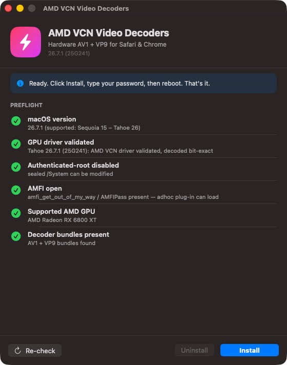

# AMD VCN Video Decoders — installer

One-window macOS app that installs the hardware AV1 + VP9 VideoToolbox decoders for AMD Navi 21
GPUs (RX 6800 / 6800 XT / 6900 XT / 6950 XT) on OpenCore hackintoshes running macOS Sequoia 15
through Tahoe 26. After a reboot, Safari and Chrome decode YouTube AV1/VP9 (up to 4K60, 8K for AV1)
on the GPU.

## For users

1. Open the DMG and drag the app to **Applications**.
2. Open it. The app is not notarized, so the first time macOS refuses: go to **System Settings →
   Privacy & Security → Open Anyway** (on Sequoia and later, right-click → Open no longer works).
3. If every check is green, click **Install**, type your password, click **Reboot now**.

The app refuses to install when something would not work or could be unsafe, and says why:

| Check | Why it matters |
|---|---|
| macOS version | only Sequoia 15 – Tahoe 26 are supported |
| GPU driver validated | the AMD driver of this exact macOS build must have been checked; an unchecked build can hang the GPU. Blocked by default, "Install anyway" asks for explicit confirmation |
| Authenticated-root disabled | needed to write the sealed system volume (`csrutil authenticated-root disable` from Recovery) |
| AMFI open | `amfi_get_out_of_my_way=0x1` or AMFIPass, else macOS rejects the decoders |
| Supported AMD GPU | warning only; Navi 21 is the known-good family |
| System video plug-ins intact | Apple's own plug-ins must be complete; if any is missing the app offers **Repair**, which copies only the missing ones back from Apple's sealed snapshot of the same macOS build (and installs the decoders in the same reboot) |
| Decoder bundles present | the app was unzipped intact |

It also detects whether the decoders are already installed and up to date (cdhash compare), and
offers **Update** or **Uninstall** accordingly. Undo everything: **Uninstall** + reboot, or
`sudo bless --mount / --last-sealed-snapshot` + reboot.

## Why /System and not /Library

VideoToolbox scans `/System/Library/Video/Plug-Ins` without a code-signature check. `/Library/Video/Plug-Ins`
requires an Apple signature, and patching that check out of CoreMedia at runtime is not possible on
Tahoe: Lilu's userspace patcher cannot patch the split dyld shared cache (see `../vcnvtkext`).

## For developers

- `engine.sh` — all logic: `check` (JSON preflight, no root), `install [--force]`, `repair [--force]`,
  `uninstall` (root). Deletions are guarded: only the two decoder bundle paths can ever be removed.
  The app is a thin SwiftUI shell around it; the CLI works the same: `sudo ./engine.sh install`.
- `validated-builds.json` — macOS builds whose driver was validated. Add a build only after
  validating its AMDRadeonVADriver2 (AV1 + VP9 paths) in IDA.
- `build-app.sh` — builds `build/AMD VCN Video Decoders.app` from `../vtav1/build` and
  `../vtvp9/build`. Embedded bundles keep their original cdhashes (only the outer app is re-signed).
- `make-dmg.sh` — packages the app into `build/AMD-VCN-Video-Decoders-<version>.dmg`.
- `make-assets.sh` — renders the app icon and the DMG background from `assets/render.swift`.
- `VCNVT_FAKE_BUILD=<build>` makes the preflight pretend another macOS build (testing the blocked path).
